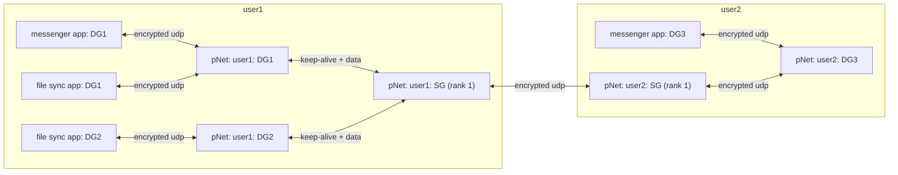

pNet devices come in two grades:

- **SG (Server Grade)**: runs on a machine with a static IP or domain name, free from NAT/firewall restrictions. If on a home network, appropriate ports are forwarded and a stable IP or DDNS is in place.
- **DG (Device Grade)**: runs on a laptop, phone, or any device that accepts whatever internet access is available. May be behind double NAT or restrictive ISP routing.

Every user on the pNet system must have at least one SG.  This is required because of how connections must be kept alive between an SG and DG to make the 2 way communication reliable.

### SG server Responsibilities and Priorities

The SG has a job to be the only device to which the DG devices owned by the user do their keep-alive communications. If a user has more than one SG device they will be ranked, so that the top-ranking SG is the one used for keep-alive. If that machine goes down (meaning it doesn't respond to keep-alive signals), the DG devices start sending their keep-alive signals to the next SG in the list.

Because only the top-ranked SG is able to send packets to the DG of that user, the rank number needs to be included in the device data of an SG.

Packet path: `DG_sender → [relay SG] → SG_recipient_top → DG_recipient`

The final hop to a recipient's DG must always go through that user's **top-ranked SG**, since it is the only SG holding an active keep-alive tunnel with the DG. The relay SG used for the first hop may be any SG from either user's pool.

The diagram shows the simple case where each user has one SG (automatically rank 1). DG1 and DG2 (both belonging to user1) maintain their keep-alive tunnels exclusively with user1's top-ranked SG. A message from the messenger app on user1's DG1 travels to user2's DG3: DG1 → SG1 → SG2 → DG3. Only SG2 can deliver to DG3 because it is user2's top-ranked SG and the only one holding an active tunnel to DG3. File data from DG1 to DG2 (same user) also routes through SG1 as the shared relay.

pNet is responsible for maintaining network location information, SG rank data, and encryption keys to connect and send packets to other pNet nodes, which then forward that data to the appropriate app on the device. The SG/DG split ensures reliable delivery even in difficult network environments (double NAT, advanced ISP routing) by guaranteeing that at least one reachable, top-ranked relay exists per user at all times.

---

## SG selection for routing

When a DG sends a packet to a remote DG, it must route through a relay SG. The selection rule is:

1. Prefer a direct connection to the **recipient's top-ranked SG** — this is the SG that holds the active keep-alive tunnel to the recipient's DG and is the only one that can deliver to it. If a connection to that SG exists, use it (2-hop path).
2. If no direct connection to the recipient's top-ranked SG is available, fall back to the best available SG by lowest measured RTT (from `poll_sg` results), which will relay onward to the recipient's top-ranked SG.

RTT-based selection naturally favours well-connected, low-latency relays without requiring any geographic metadata.

### Intra-user routing (DG to DG, same user)

The same rule applies. All of a user's DGs keep their keep-alive with the user's rank 1 SG. That SG is always `SG_dest` for any intra-user delivery, regardless of which DG is sending or receiving. The rank 1 SG is effectively the hub for all of that user's DG traffic until a failover event promotes rank 2 to rank 1.

---

## No opaque bulk tunnel

A device still sends app packets through a server. The server opens each one and forwards it. There is no second line that, after a packet count, carries a sealed device-to-device blob the server does not open.

Opcodes `0x50`–`0x54` are retired. A node drops them. Bulk traffic uses the same server forward, or the LAN shortcut and hole punch in `descriptions/direct-path.md` when that path is up.
